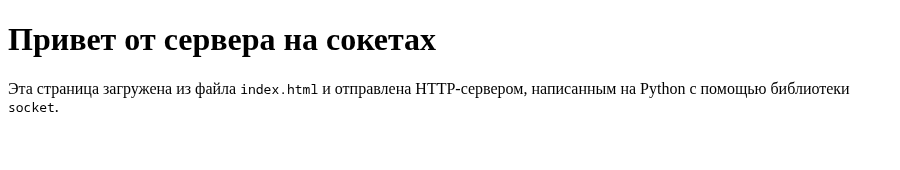
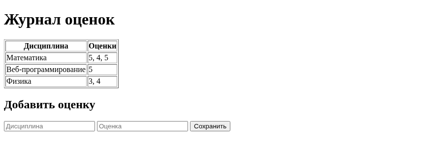

# Лабораторная работа 1. Работа с сокетами

Выполнил: Шайхиев Эльдар Ильхамович, группа K3339.

**Цель работы:** понять принципы межсокетного взаимодействия в вебе, научиться реализовывать
базовую архитектуру клиент-сервер.

Все программы написаны на Python 3 и используют только стандартную библиотеку (`socket`,
`threading`). Код лежит в `students/K3339/laboratory_works/Shaykhiev_Eldar/laboratory_work_1/`, у каждого задания
своя папка и свой порт, поэтому серверы можно запускать одновременно:

```text
laboratory_work_1/
  task1/  server.py, client.py     UDP, порт 8080
  task2/  server.py, client.py     TCP, порт 8081
  task3/  server.py, index.html    HTTP, порт 8082
  task4/  server.py, client.py     чат, TCP + threading, порт 8083
  task5/  server.py                веб-сервер GET/POST, порт 8084
```

Порядок запуска везде одинаковый: сначала сервер, потом клиент в отдельном терминале.

## Задание 1. Обмен сообщениями по UDP

**Условие.** Клиент отправляет серверу сообщение «Hello, server», сервер его выводит и отвечает
«Hello, client», которое выводит клиент. Использовать `socket` и протокол UDP.

### Описание протокола

UDP работает без установления соединения: сокет создаётся с типом `SOCK_DGRAM`, и каждое
сообщение уходит отдельной датаграммой. Поэтому у сервера нет `listen()` и `accept()`: он
привязывается к адресу через `bind()` и ждёт датаграммы в `recvfrom()`. Этот метод возвращает
данные вместе с адресом отправителя, и ответ уходит на этот адрес через `sendto()`.
Клиенту `bind()` не нужен: при первом `sendto()` система сама назначает ему свободный порт.

| Шаг | Кто | Вызов | Данные |
|---|---|---|---|
| 1 | клиент | `sendto(..., ('localhost', 8080))` | `Hello, server` |
| 2 | сервер | `recvfrom(BUFFER_SIZE)` → данные и адрес клиента | |
| 3 | сервер | `sendto(..., client_address)` | `Hello, client` |
| 4 | клиент | `recvfrom(BUFFER_SIZE)` | |

Строки переводятся в байты через `encode()` и обратно через `decode()` (UTF-8).

### Код

```python title="task1/server.py"
import socket

HOST = 'localhost'
PORT = 8080
# Сколько байт забираем за один вызов recv, а не размер сообщения
BUFFER_SIZE = 1024

# SOCK_DGRAM = UDP: соединение не устанавливается, listen/accept не нужны
server_socket = socket.socket(socket.AF_INET, socket.SOCK_DGRAM)
server_socket.bind((HOST, PORT))
print(f'UDP-сервер запущен на {HOST}:{PORT}...')

while True:
    # recvfrom возвращает и данные, и адрес отправителя, по нему отвечаем
    data, client_address = server_socket.recvfrom(BUFFER_SIZE)
    print(f'Сообщение от {client_address}: {data.decode()}')

    server_socket.sendto('Hello, client'.encode(), client_address)
```

```python title="task1/client.py"
import socket

HOST = 'localhost'
PORT = 8080
# Сколько байт забираем за один вызов recv, а не размер сообщения
BUFFER_SIZE = 1024

client_socket = socket.socket(socket.AF_INET, socket.SOCK_DGRAM)

# Без connect: адрес получателя указывается в каждом sendto
client_socket.sendto('Hello, server'.encode(), (HOST, PORT))

data, server_address = client_socket.recvfrom(BUFFER_SIZE)
print(f'Ответ от сервера {server_address}: {data.decode()}')

client_socket.close()
```

### Пример работы

```text
$ python task1/server.py
UDP-сервер запущен на localhost:8080...
Сообщение от ('127.0.0.1', 44268): Hello, server
```

```text
$ python task1/client.py
Ответ от сервера ('127.0.0.1', 8080): Hello, client
```

Порт клиента (44268) система выбрала сама, по нему сервер и отправил ответ.

## Задание 2. Вычисления через TCP

**Условие.** Клиент запрашивает выполнение математической операции, параметры вводятся с
клавиатуры, сервер вычисляет и возвращает результат. Использовать `socket` и протокол TCP.

**Вариант.** Номер в журнале 35, варианты идут по кругу с шагом 4: (35 − 1) mod 4 + 1 = 3, то есть
вариант 3 - **площадь трапеции**: `S = (a + b) / 2 * h`, где `a` и `b` - основания, `h` - высота.

### Описание протокола

TCP сначала устанавливает соединение: сервер вызывает `bind()`, `listen()` и в цикле `accept()`,
клиент вызывает `connect()`. После этого обе стороны пишут и читают через `sendall()` и `recv()`.

| Шаг | Кто | Данные |
|---|---|---|
| 1 | клиент | вводит `a`, `b`, `h` с клавиатуры, подключается к серверу |
| 2 | клиент → сервер | строка из трёх чисел через пробел, например `3 5 4` |
| 3 | сервер | разбирает строку, проверяет, что это три положительных числа, считает площадь |
| 4 | сервер → клиент | `Площадь трапеции: 16.0` или текст ошибки |
| 5 | сервер | закрывает соединение и ждёт следующего клиента |

Проверка входных данных сделана на сервере, потому что считает и отвечает за результат он.
Если прислали не числа или неположительные значения, клиент получает понятное сообщение об ошибке,
а сервер продолжает работать. Соединение с клиентом закрывается в `finally`, то есть при любом
исходе, а непредвиденная ошибка (например, байты не в UTF-8) ловится `except Exception`:
сервер печатает её и ждёт следующего клиента. Так же устроены серверы заданий 3 и 5.

Опция `SO_REUSEADDR` позволяет сразу перезапустить сервер на том же порту. Без неё после остановки
порт какое-то время занят (состояние `TIME_WAIT`), и `bind()` падает с «Address already in use».

### Код

```python title="task2/server.py"
import socket

HOST = 'localhost'
PORT = 8081
# Сколько байт забираем за один вызов recv, а не размер сообщения
BUFFER_SIZE = 1024
# Сколько подключений ОС держит в очереди, пока сервер не вызвал accept()
BACKLOG = 1


def parse_params(request):
    # Запрос приходит строкой вида "a b h"; текст ValueError уходит клиенту
    try:
        a, b, h = map(float, request.split())
    except ValueError:
        raise ValueError('нужно передать три числа: a, b и h') from None
    if a <= 0 or b <= 0 or h <= 0:
        raise ValueError('основания и высота должны быть положительными')
    return a, b, h


def trapezoid_area(a, b, h):
    return (a + b) / 2 * h


server_socket = socket.socket(socket.AF_INET, socket.SOCK_STREAM)
server_socket.setsockopt(socket.SOL_SOCKET, socket.SO_REUSEADDR, 1)
server_socket.bind((HOST, PORT))
server_socket.listen(BACKLOG)
print(f'TCP-сервер запущен на {HOST}:{PORT}...')

while True:
    client_connection, client_address = server_socket.accept()
    try:
        print(f'Подключение от {client_address}')

        request = client_connection.recv(BUFFER_SIZE).decode()
        print(f'Параметры: {request}')

        try:
            response = f'Площадь трапеции: {trapezoid_area(*parse_params(request))}'
        except ValueError as error:
            response = f'Ошибка: {error}'
        print(response)
        client_connection.sendall(response.encode())
    except Exception as error:
        # Неожиданная ошибка в одном запросе не должна останавливать весь сервер
        print(f'Ошибка при обработке запроса от {client_address}: {error!r}')
    finally:
        # Соединение закрывается, даже если при обработке запроса случилась ошибка
        client_connection.close()
```

```python title="task2/client.py"
import socket

HOST = 'localhost'
PORT = 8081
# Сколько байт забираем за один вызов recv, а не размер сообщения
BUFFER_SIZE = 1024

print('Площадь трапеции S = (a + b) / 2 * h')
a = input('Основание a: ')
b = input('Основание b: ')
h = input('Высота h: ')

client_socket = socket.socket(socket.AF_INET, socket.SOCK_STREAM)
client_socket.connect((HOST, PORT))

client_socket.sendall(f'{a} {b} {h}'.encode())

response = client_socket.recv(BUFFER_SIZE).decode()
print(response)

client_socket.close()
```

### Пример работы

```text
$ python task2/client.py
Площадь трапеции S = (a + b) / 2 * h
Основание a: 3
Основание b: 5
Высота h: 4
Площадь трапеции: 16.0
$ python task2/client.py
Площадь трапеции S = (a + b) / 2 * h
Основание a: 2.5
Основание b: 7
Высота h: 3
Площадь трапеции: 14.25
$ python task2/client.py
Площадь трапеции S = (a + b) / 2 * h
Основание a: десять
Основание b: 7
Высота h: 3
Ошибка: нужно передать три числа: a, b и h
$ python task2/client.py
Площадь трапеции S = (a + b) / 2 * h
Основание a: 4
Основание b: 6
Высота h: -2
Ошибка: основания и высота должны быть положительными
```

```text
$ python task2/server.py
TCP-сервер запущен на localhost:8081...
Подключение от ('127.0.0.1', 52908)
Параметры: 3 5 4
Площадь трапеции: 16.0
Подключение от ('127.0.0.1', 52920)
Параметры: 2.5 7 3
Площадь трапеции: 14.25
Подключение от ('127.0.0.1', 52936)
Параметры: десять 7 3
Ошибка: нужно передать три числа: a, b и h
Подключение от ('127.0.0.1', 52938)
Параметры: 4 6 -2
Ошибка: основания и высота должны быть положительными
```

Проверка вручную: (3 + 5) / 2 · 4 = 16, (2.5 + 7) / 2 · 3 = 14.25.

## Задание 3. Раздача HTML-страницы по HTTP

**Условие.** Клиент подключается к серверу и получает HTTP-сообщение с HTML-страницей, которую
сервер загружает из файла `index.html`. Использовать `socket`.

### Описание протокола

HTTP - текстовый протокол поверх TCP. Клиентом здесь выступает браузер или `curl`: он подключается
и присылает запрос, первая строка которого - метод, путь и версия (`GET / HTTP/1.1`). Сервер
отвечает сообщением строгого формата:

```text
HTTP/1.1 200 OK                             ← строка статуса
Content-Type: text/html; charset=utf-8      ← заголовки
Content-Length: 464
Connection: close
                                            ← пустая строка (\r\n)
<!DOCTYPE html> ...                         ← тело
```

Строки разделяются `\r\n`, заголовки отделяются от тела пустой строкой. `Content-Length` - длина
тела **в байтах**, поэтому она считается после `encode()`. Если посчитать `len()` от строки,
для кириллицы получится число символов, а не байт: один русский символ в UTF-8 занимает два байта.
Браузер тогда обрежет страницу. `Connection: close` сообщает, что после ответа сервер закроет
соединение.

Файл читается при каждом запросе, поэтому правки в `index.html` видны без перезапуска сервера.
Путь к нему строится от расположения скрипта (`Path(__file__).with_name(...)`), так что сервер
работает из любого текущего каталога.

### Код

```python title="task3/server.py"
import socket
from pathlib import Path

HOST = 'localhost'
PORT = 8082
# Сколько байт забираем за один вызов recv, а не размер сообщения
BUFFER_SIZE = 1024
# Сколько подключений ОС держит в очереди, пока сервер не вызвал accept()
BACKLOG = 5

# index.html лежит рядом со скриптом, откуда бы его ни запускали
INDEX_PATH = Path(__file__).with_name('index.html')

server_socket = socket.socket(socket.AF_INET, socket.SOCK_STREAM)
server_socket.setsockopt(socket.SOL_SOCKET, socket.SO_REUSEADDR, 1)
server_socket.bind((HOST, PORT))
server_socket.listen(BACKLOG)
print(f'HTTP-сервер запущен на http://{HOST}:{PORT}/')

while True:
    client_connection, client_address = server_socket.accept()
    try:
        request = client_connection.recv(BUFFER_SIZE).decode()
        # Первая строка запроса: метод, путь, версия протокола
        request_line = request.split('\r\n')[0]
        print(f'{client_address}: {request_line}')

        body = INDEX_PATH.read_text(encoding='utf-8').encode()

        # Content-Length - длина тела в байтах, поэтому считаем после encode()
        headers = (
            'HTTP/1.1 200 OK\r\n'
            'Content-Type: text/html; charset=utf-8\r\n'
            f'Content-Length: {len(body)}\r\n'
            'Connection: close\r\n'
            '\r\n'
        )
        client_connection.sendall(headers.encode() + body)
    except Exception as error:
        # Неожиданная ошибка в одном запросе не должна останавливать весь сервер
        print(f'Ошибка при обработке запроса от {client_address}: {error!r}')
    finally:
        # Соединение закрывается, даже если при обработке запроса случилась ошибка
        client_connection.close()
```

```html title="task3/index.html"
<!DOCTYPE html>
<html lang="ru">
<head>
    <meta charset="utf-8">
    <title>Лабораторная работа 1</title>
</head>
<body>
    <h1>Привет от сервера на сокетах</h1>
    <p>Эта страница загружена из файла <code>index.html</code> и отправлена
       HTTP-сервером, написанным на Python с помощью библиотеки <code>socket</code>.</p>
</body>
</html>
```

### Пример работы

```text
$ python task3/server.py
HTTP-сервер запущен на http://localhost:8082/
('127.0.0.1', 32776): GET / HTTP/1.1
```

```text
$ curl -i http://localhost:8082/
HTTP/1.1 200 OK
Content-Type: text/html; charset=utf-8
Content-Length: 464
Connection: close

<!DOCTYPE html>
<html lang="ru">
<head>
    <meta charset="utf-8">
    <title>Лабораторная работа 1</title>
</head>
<body>
    <h1>Привет от сервера на сокетах</h1>
    <p>Эта страница загружена из файла <code>index.html</code> и отправлена
       HTTP-сервером, написанным на Python с помощью библиотеки <code>socket</code>.</p>
</body>
</html>
```

`Content-Length: 464` совпадает с размером `index.html` в байтах (`wc -c index.html` → 464).

Страница в браузере по адресу `http://localhost:8082/`:



## Задание 4. Многопользовательский чат

**Условие.** Реализовать многопользовательский чат: `socket` + `threading`, пользователей можно
идентифицировать, пользователь может выйти из чата. Выбран протокол TCP (100% баллов).

### Описание протокола

| Шаг | Кто | Данные |
|---|---|---|
| 1 | клиент → сервер | первое сообщение после подключения - имя пользователя |
| 2 | сервер → клиент | приветствие и список тех, кто уже в чате |
| 3 | сервер → остальные | `* Пользователь <имя> вошёл в чат` |
| 4 | клиент → сервер | текст сообщения |
| 5 | сервер → все, кроме отправителя | `<имя>: <текст>` |
| 6 | клиент → сервер | `/exit` - выход; сервер закрывает соединение |
| 7 | сервер → остальные | `* Пользователь <имя> вышел из чата` |

**Сервер.** Главный поток только принимает подключения (`accept()`), а каждое подключение
обслуживает отдельный поток `handle_client`. Иначе, пока сервер ждёт `recv()` от одного клиента,
остальные не могли бы ни подключиться, ни писать. Активные пользователи хранятся в словаре
`clients` вида «сокет → имя»: по сокету отправляется сообщение, по имени пользователь
идентифицируется. Со словарём работают сразу несколько потоков, поэтому доступ к нему закрыт
блокировкой `threading.Lock`. Без неё один поток мог бы удалять клиента, пока другой обходит
словарь при рассылке.

TCP передаёт поток байт, а не отдельные сообщения: два сообщения, отправленные подряд, могут
прийти одним `recv()`, а длинное - разбиться на два. Поэтому границей сообщения служит символ
`\n` в обе стороны. Клиент добавляет его к имени и к каждому сообщению, а сервер читает сокет
построчно через `connection.makefile()`: `readline()` возвращает ровно одну строку, даже если в
одном сегменте пришли две, и ждёт, если строка пришла не целиком. Сервер тоже завершает каждое
сообщение символом `\n`, поэтому у клиента склеенные сообщения выводятся на разных строках.

Выход обрабатывается двумя способами: по команде `/exit` и при обрыве соединения. Если клиент
закрыл терминал, `readline()` вернёт пустую строку или бросит `ConnectionResetError`. Уборка
клиента (удалить из словаря, закрыть сокет, оповестить остальных) стоит в блоке `finally`, поэтому
выполняется при любом выходе, даже при неожиданной ошибке в потоке этого клиента.

**Клиент.** Это один скрипт на всех пользователей: имя вводится при запуске, в коде ничего не
захардкожено. Клиенту одновременно нужно ждать ввода с клавиатуры (`input()`) и принимать
сообщения из сети (`readline()`). Оба вызова блокирующие, поэтому приём вынесен в отдельный поток
`receive_messages`. Поток помечен `daemon=True` и завершается вместе с программой после `/exit`.
Сокет клиент читает так же, как сервер, через `makefile()`: русская буква в UTF-8 занимает два
байта, и в длинном сообщении могла бы разрезаться между двумя порциями данных, а файл-обёртка
сама склеивает такие байты. Ctrl+C и Ctrl+D тоже работают как выход: клиент ловит
`KeyboardInterrupt` и `EOFError` и отправляет серверу `/exit`.

### Код

```python title="task4/server.py"
import socket
import threading

HOST = 'localhost'
PORT = 8083
# Сколько подключений ОС держит в очереди, пока сервер не вызвал accept()
BACKLOG = 5

clients = {}  # сокет клиента -> имя пользователя
clients_lock = threading.Lock()


def broadcast(message, sender=None):
    # Рассылаем всем подключённым, кроме отправителя.
    # TCP - поток байт без границ сообщений: два сообщения подряд могут прийти
    # одним recv, поэтому каждое заканчиваем переводом строки
    with clients_lock:
        for client in clients:
            if client is not sender:
                try:
                    client.sendall(f'{message}\n'.encode())
                except OSError:
                    pass  # клиент уже отключился, его уберёт свой поток


def handle_client(connection, address):
    # Клиент заканчивает каждое сообщение переводом строки, поэтому сокет читаем
    # как текстовый файл: readline() отдаёт ровно одно сообщение
    reader = connection.makefile('r', encoding='utf-8')
    # finally выполнится при любом выходе: /exit, отключение клиента или неожиданная ошибка,
    # поэтому клиент не останется в списке «призраком»
    try:
        # Первая строка от клиента - его имя
        name = reader.readline().strip()

        with clients_lock:
            online = ', '.join(clients.values()) or 'никого'
            clients[connection] = name
        connection.sendall(f'Добро пожаловать, {name}! Сейчас в чате: {online}\n'.encode())
        print(f'Пользователь {name} подключился с адреса {address}')
        broadcast(f'* Пользователь {name} вошёл в чат', connection)

        while True:
            try:
                line = reader.readline()
            except ConnectionResetError:
                break
            # readline() вернул пустую строку: клиент закрыл соединение
            if not line:
                break
            message = line.strip()
            if message == '/exit':
                break
            print(f'{name}: {message}')
            broadcast(f'{name}: {message}', connection)
    finally:
        with clients_lock:
            # Клиента может не быть в списке, если ошибка случилась ещё до ввода имени
            name = clients.pop(connection, None)
        # Сокет закроется по-настоящему, только когда закрыт и файл-обёртка
        reader.close()
        connection.close()
        if name is not None:
            print(f'Пользователь {name} отключился')
            broadcast(f'* Пользователь {name} вышел из чата')


server_socket = socket.socket(socket.AF_INET, socket.SOCK_STREAM)
server_socket.setsockopt(socket.SOL_SOCKET, socket.SO_REUSEADDR, 1)
server_socket.bind((HOST, PORT))
server_socket.listen(BACKLOG)
print(f'Сервер чата запущен на {HOST}:{PORT}...')

while True:
    connection, address = server_socket.accept()
    # Каждого клиента обслуживает свой поток, главный сразу ждёт следующего
    threading.Thread(target=handle_client, args=(connection, address), daemon=True).start()
```

```python title="task4/client.py"
import socket
import threading

HOST = 'localhost'
PORT = 8083


def receive_messages(reader):
    # Отдельный поток: печатает входящие сообщения, пока главный ждёт ввода
    while True:
        try:
            line = reader.readline()
        except (OSError, ValueError):
            break
        if not line:
            print('Соединение с сервером закрыто')
            break
        # Сообщения уже заканчиваются переводом строки
        print(line, end='')


client_socket = socket.socket(socket.AF_INET, socket.SOCK_STREAM)
client_socket.connect((HOST, PORT))
# Как и на сервере, сокет читаем как текстовый файл: readline() отдаёт сообщение целиком,
# даже если буква UTF-8 пришла разрезанной между двумя порциями байт
reader = client_socket.makefile('r', encoding='utf-8')

name = input('Ваше имя: ')
client_socket.sendall(f'{name}\n'.encode())
# Приветствие выводим до запуска потока приёма, чтобы оно шло первым
print(reader.readline(), end='')
print('Для выхода из чата введите /exit')

threading.Thread(target=receive_messages, args=(reader,), daemon=True).start()

try:
    while True:
        message = input()
        client_socket.sendall(f'{message}\n'.encode())
        if message == '/exit':
            break
except (KeyboardInterrupt, EOFError):
    # Ctrl+C или Ctrl+D: выходим так же, как по /exit, без трассировки ошибки
    try:
        client_socket.sendall('/exit\n'.encode())
    except OSError:
        pass  # сервер уже недоступен
finally:
    reader.close()
    client_socket.close()
```

### Пример работы

Сервер и три клиента в четырёх терминалах. Анна, Иван и Олег заходят по очереди, переписываются,
потом выходят:

```text
$ python task4/server.py
Сервер чата запущен на localhost:8083...
Пользователь Анна подключился с адреса ('127.0.0.1', 47508)
Пользователь Иван подключился с адреса ('127.0.0.1', 47514)
Пользователь Олег подключился с адреса ('127.0.0.1', 47524)
Анна: Всем привет!
Иван: Привет, Анна
Олег: Я ненадолго, уже ухожу
Пользователь Олег отключился
Анна: Пока, Олег
Пользователь Иван отключился
Пользователь Анна отключился
```

```text
$ python task4/client.py
Ваше имя: Анна
Добро пожаловать, Анна! Сейчас в чате: никого
Для выхода из чата введите /exit
* Пользователь Иван вошёл в чат
* Пользователь Олег вошёл в чат
Всем привет!
Иван: Привет, Анна
Олег: Я ненадолго, уже ухожу
* Пользователь Олег вышел из чата
Пока, Олег
* Пользователь Иван вышел из чата
/exit
Соединение с сервером закрыто
```

```text
$ python task4/client.py
Ваше имя: Иван
Добро пожаловать, Иван! Сейчас в чате: Анна
Для выхода из чата введите /exit
* Пользователь Олег вошёл в чат
Анна: Всем привет!
Привет, Анна
Олег: Я ненадолго, уже ухожу
* Пользователь Олег вышел из чата
Анна: Пока, Олег
/exit
Соединение с сервером закрыто
```

```text
$ python task4/client.py
Ваше имя: Олег
Добро пожаловать, Олег! Сейчас в чате: Анна, Иван
Для выхода из чата введите /exit
Анна: Всем привет!
Иван: Привет, Анна
Я ненадолго, уже ухожу
/exit
Соединение с сервером закрыто
```

Каждый видит чужие сообщения с именем автора, свои сообщения ему не дублируются. О входе и выходе
пользователей узнают все остальные.

## Задание 5. Простой веб-сервер (GET/POST)

**Условие.** Написать на `socket` веб-сервер, который принимает и записывает дисциплину и оценку по
ней (POST), а также отдаёт все оценки в виде HTML-страницы (GET). Оценки группируются по дисциплине.

### Описание протокола

Один запрос обрабатывает функция `handle_request`: читает его, выбирает ответ и, если это форма,
передаёт тело в `add_grade`. HTTP-запрос разбирается вручную в `read_request`:

1. Данные читаются из сокета, пока не встретится `\r\n\r\n` - конец заголовков.
2. Первая строка делится на метод, путь и версию: `POST / HTTP/1.1`.
3. Остальные строки до пустой - заголовки `Имя: значение`, они складываются в словарь.
4. После заголовков идёт тело. Его длина указана в `Content-Length`, и если тело пришло не
   целиком, сервер дочитывает его до нужного числа байт.

Форма отправляет тело в формате `application/x-www-form-urlencoded`:
`discipline=%D0%9C%D0%B0...&grade=5`. Кириллица в нём закодирована через `%XX`, поэтому поля
декодируются функцией `urllib.parse.parse_qs`.

| Метод | Путь | Что делает сервер | Ответ |
|---|---|---|---|
| GET | `/` | собирает страницу с таблицей оценок и формой добавления | `200 OK` + HTML |
| POST | `/` | сохраняет оценку (поля `discipline`, `grade`) | `303 See Other`, `Location: /` |
| POST | `/` | не заполнено одно из полей | `400 Bad Request` |
| любой | любой | запрос не разобрать: первая строка не из трёх частей, `Content-Length` не число, байты не в UTF-8 | `400 Bad Request` |
| любой | другой | - | `404 Not Found` |

После успешного POST сервер отвечает не страницей, а перенаправлением `303 See Other` на `/`.
Браузер сам делает GET и показывает обновлённый журнал, а обновление страницы (F5) не отправляет
форму повторно (шаблон Post/Redirect/Get).

### Хранение оценок

Журнал - словарь, где ключ - название дисциплины, а значение - список оценок:

```python
grades = {
    'Математика': ['5', '4', '5'],
    'Физика': ['3', '4'],
}
```

Словарь хорошо подходит для группировки: поиск дисциплины по названию выполняется за O(1), а
`grades.setdefault(discipline, []).append(grade)` в одной строке создаёт запись для новой
дисциплины или дописывает оценку в существующую. Вторая оценка по «Математике» попадает в тот же
список, отдельная строка с тем же названием не появляется. Данные хранятся в памяти процесса,
поэтому после перезапуска сервера журнал пустой.

Название дисциплины приходит от пользователя, поэтому при выводе в HTML оно экранируется
`html.escape()`. Иначе введённый `<script>` выполнился бы на странице.

### Код

```python title="task5/server.py"
import html
import socket
from urllib.parse import parse_qs

HOST = 'localhost'
PORT = 8084
# Сколько байт забираем за один вызов recv, а не размер сообщения
BUFFER_SIZE = 1024
# Сколько подключений ОС держит в очереди, пока сервер не вызвал accept()
BACKLOG = 5

# Журнал: дисциплина -> список оценок по ней
grades = {}


def read_request(connection):
    # Читаем, пока не дошли до пустой строки, отделяющей заголовки от тела
    data = b''
    while b'\r\n\r\n' not in data:
        chunk = connection.recv(BUFFER_SIZE)
        if not chunk:
            return None
        data += chunk

    head, _, body = data.partition(b'\r\n\r\n')
    lines = head.decode().split('\r\n')
    method, path, _ = lines[0].split(' ')

    headers = {}
    for line in lines[1:]:
        key, _, value = line.partition(':')
        headers[key.strip().lower()] = value.strip()

    # Тело может прийти не целиком, дочитываем до Content-Length байт
    length = int(headers.get('content-length', 0))
    while len(body) < length:
        chunk = connection.recv(BUFFER_SIZE)
        if not chunk:
            return None
        body += chunk

    return method, path, body.decode()


def send_response(connection, status, body='', extra_headers=''):
    body = body.encode()
    response = (
        f'HTTP/1.1 {status}\r\n'
        'Content-Type: text/html; charset=utf-8\r\n'
        f'Content-Length: {len(body)}\r\n'
        f'{extra_headers}'
        'Connection: close\r\n'
        '\r\n'
    )
    connection.sendall(response.encode() + body)


def grades_page():
    if grades:
        rows = ''
        for discipline, marks in grades.items():
            rows += (f'<tr><td>{html.escape(discipline)}</td>'
                     f'<td>{html.escape(", ".join(marks))}</td></tr>\n')
        table = f'<table border="1">\n<tr><th>Дисциплина</th><th>Оценки</th></tr>\n{rows}</table>'
    else:
        table = '<p>Оценок пока нет.</p>'

    return f'''<!DOCTYPE html>
<html lang="ru">
<head><meta charset="utf-8"><title>Журнал оценок</title></head>
<body>
<h1>Журнал оценок</h1>
{table}
<h2>Добавить оценку</h2>
<form method="post" action="/">
    <input name="discipline" placeholder="Дисциплина" required>
    <input name="grade" placeholder="Оценка" required>
    <button type="submit">Сохранить</button>
</form>
</body>
</html>'''


def add_grade(connection, body):
    # Тело формы: discipline=...&grade=... (application/x-www-form-urlencoded)
    form = parse_qs(body)
    discipline = form.get('discipline', [''])[0].strip()
    grade = form.get('grade', [''])[0].strip()

    if discipline and grade:
        grades.setdefault(discipline, []).append(grade)
        print(f'Сохранено: {discipline}: {grade}')
        # После POST отправляем браузер обратно на страницу журнала
        send_response(connection, '303 See Other', extra_headers='Location: /\r\n')
    else:
        send_response(connection, '400 Bad Request',
                      '<h1>400</h1><p>Нужно указать дисциплину и оценку.</p>')


def handle_request(connection, address):
    # Один запрос: прочитать, разобрать и ответить. Ошибки, которых здесь не ждём,
    # ловит главный цикл, чтобы сервер работал дальше
    try:
        request = read_request(connection)
    except ValueError:
        # Первая строка не из трёх частей, Content-Length не число или байты не в UTF-8
        # (UnicodeDecodeError - подкласс ValueError)
        send_response(connection, '400 Bad Request', '<h1>400</h1><p>Некорректный запрос.</p>')
        return

    # Клиент закрыл соединение, так и не прислав запрос целиком
    if request is None:
        return

    method, path, body = request
    print(f'{address}: {method} {path}')

    if method == 'GET' and path == '/':
        send_response(connection, '200 OK', grades_page())
    elif method == 'POST' and path == '/':
        add_grade(connection, body)
    else:
        send_response(connection, '404 Not Found', '<h1>404</h1><p>Страница не найдена.</p>')


server_socket = socket.socket(socket.AF_INET, socket.SOCK_STREAM)
server_socket.setsockopt(socket.SOL_SOCKET, socket.SO_REUSEADDR, 1)
server_socket.bind((HOST, PORT))
server_socket.listen(BACKLOG)
print(f'Веб-сервер запущен на http://{HOST}:{PORT}/')

while True:
    client_connection, client_address = server_socket.accept()
    try:
        handle_request(client_connection, client_address)
    except Exception as error:
        # Неожиданная ошибка в одном запросе не должна останавливать весь сервер
        print(f'Ошибка при обработке запроса от {client_address}: {error!r}')
    finally:
        # Соединение закрывается, даже если при обработке запроса случилась ошибка
        client_connection.close()
```

### Пример работы

Добавление оценок и запросы через `curl`:

```text
$ curl -i -d 'discipline=Математика&grade=5' http://localhost:8084/
HTTP/1.1 303 See Other
Content-Type: text/html; charset=utf-8
Content-Length: 0
Location: /
Connection: close

$ curl -s -d 'discipline=Математика&grade=4' http://localhost:8084/
$ curl -s -d 'discipline=Физика&grade=3' http://localhost:8084/
$ curl -i -d 'discipline=Физика' http://localhost:8084/
HTTP/1.1 400 Bad Request
Content-Type: text/html; charset=utf-8
Content-Length: 82
Connection: close

<h1>400</h1><p>Нужно указать дисциплину и оценку.</p>
$ curl http://localhost:8084/
<!DOCTYPE html>
<html lang="ru">
<head><meta charset="utf-8"><title>Журнал оценок</title></head>
<body>
<h1>Журнал оценок</h1>
<table border="1">
<tr><th>Дисциплина</th><th>Оценки</th></tr>
<tr><td>Математика</td><td>5, 4</td></tr>
<tr><td>Физика</td><td>3</td></tr>
</table>
<h2>Добавить оценку</h2>
<form method="post" action="/">
    <input name="discipline" placeholder="Дисциплина" required>
    <input name="grade" placeholder="Оценка" required>
    <button type="submit">Сохранить</button>
</form>
</body>
</html>
```

```text
$ python task5/server.py
Веб-сервер запущен на http://localhost:8084/
('127.0.0.1', 50794): POST /
Сохранено: Математика: 5
('127.0.0.1', 50804): POST /
Сохранено: Математика: 4
('127.0.0.1', 50820): POST /
Сохранено: Физика: 3
('127.0.0.1', 50836): POST /
('127.0.0.1', 50844): GET /
```

Две оценки по «Математике» попали в одну строку таблицы (`5, 4`).

Страница в браузере после нескольких добавлений:



## Вывод

В ходе работы реализованы клиент-серверные приложения на сокетах:

- обмен датаграммами по UDP, без установления соединения;
- вычисление площади трапеции через TCP-соединение;
- HTTP-сервер, который вручную формирует ответ и отдаёт страницу из файла;
- многопользовательский чат на TCP, где каждого клиента обслуживает свой поток;
- веб-сервер, который разбирает GET- и POST-запросы и хранит оценки сгруппированными по
  дисциплинам.

На практике видна разница между протоколами. UDP проще, но не гарантирует доставку. TCP
гарантирует доставку и порядок байт, но передаёт поток без границ сообщений, так что границы
приходится задавать самому. HTTP - договорённость о формате текста поверх TCP, и его можно
реализовать вручную на обычном сокете.
