# Практики 2.1–2.3. Django: автовладельцы

Проект `django_project_shaykhiev`, приложение `project_first_app`, база SQLite (как в методичке).
Код: `students/K3339/laboratory_works/Shaykhiev_Eldar/practical_works/django_project_shaykhiev/`.

## Практика 2.1. Модель, админка, первое представление

**Модель данных** по рисунку 2 методички: автовладелец, автомобиль, владение и водительское
удостоверение. Таблицы и поля названы латиницей, подписи для админки - через `verbose_name`.

| Сущность на схеме | Модель | Особенности |
|---|---|---|
| Автовладелец | `CarOwner` | после практики 2.3 - пользователь (`AbstractUser`), фамилия и имя - `last_name`, `first_name` |
| Автомобиль | `Car` | гос. номер, марка, модель, цвет (может быть пустым) |
| Владение | `Ownership` | ассоциативная сущность: FK на владельца и машину, дата начала, дата окончания (пустая - владеет до сих пор) |
| Водительское удостоверение | `DriverLicense` | FK на владельца, номер, тип (поле выбора `choices`: A, B, C, D), дата выдачи |

Даты на схеме помечены как `datetime`, но время здесь не нужно, поэтому использован `DateField`.

??? info "models.py"
    ```python
    --8<-- "students/K3339/laboratory_works/Shaykhiev_Eldar/practical_works/django_project_shaykhiev/project_first_app/models.py"
    ```

Миграции: `python manage.py makemigrations` создал `0001_initial.py` с четырьмя моделями,
`python manage.py migrate` применил её.

**Админка.** Все модели зарегистрированы в `admin.py`, создан суперпользователь. Через админку
добавлены два владельца и четыре автомобиля. Каждый владелец связан с тремя машинами, даты
владения не пересекаются: Иванов продал Camry в 2014 году, после этого её купил Петров, и так
далее.

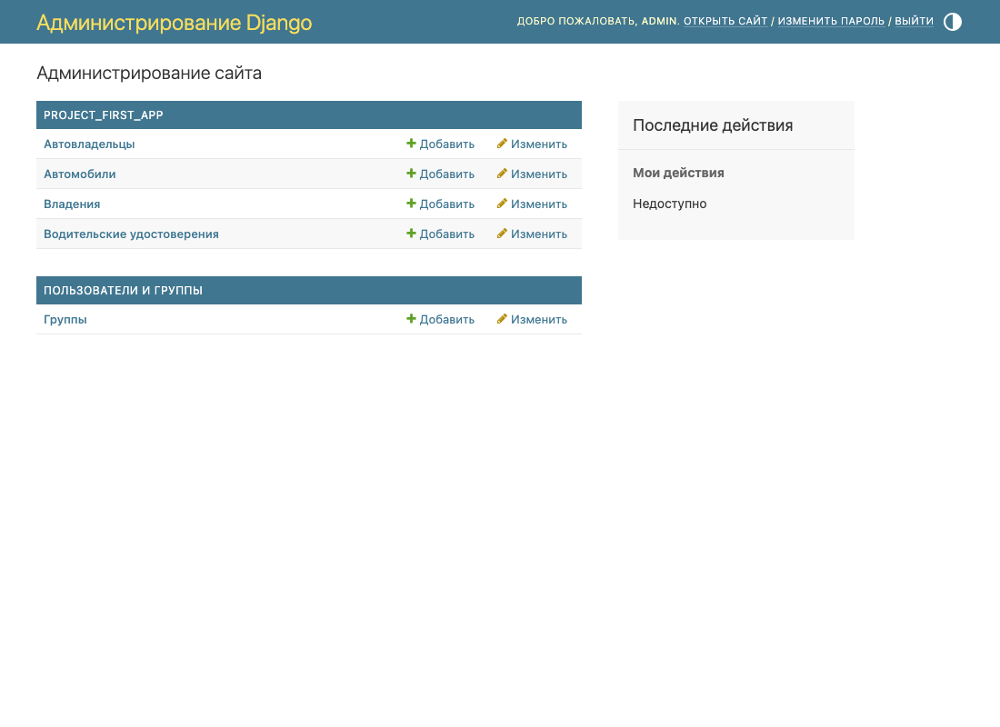

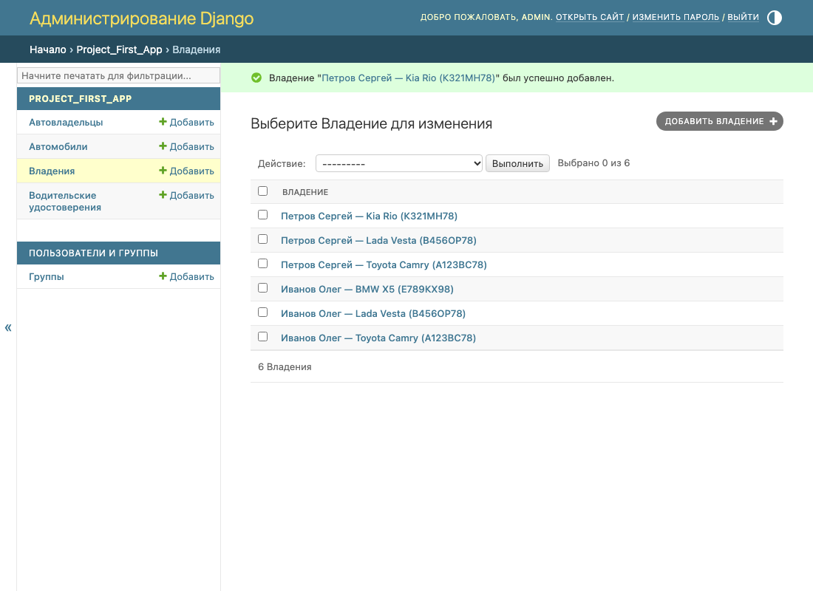

**Представление владельца по id** (`owner_detail`) и шаблон `templates/owner.html`. Маршрут
`owner/<int:owner_id>/` описан в `urls.py` приложения, который подключён к главному `urls.py`
через `include()`.

```python title="project_first_app/views.py"
def owner_detail(request, owner_id):
    try:
        owner = CarOwner.objects.get(pk=owner_id)
    except CarOwner.DoesNotExist:
        raise Http404('Владелец не найден')
    return render(request, 'owner.html', {'owner': owner})
```

```python title="django_project_shaykhiev/urls.py"
urlpatterns = [
    path('admin/', admin.site.urls),
    path('', include('project_first_app.urls')),
]
```

После практики 2.3 владельцы - это пользователи, поэтому `/owner/1/` - суперпользователь
`admin`, созданный первым. Первый автовладелец - `/owner/2/`:

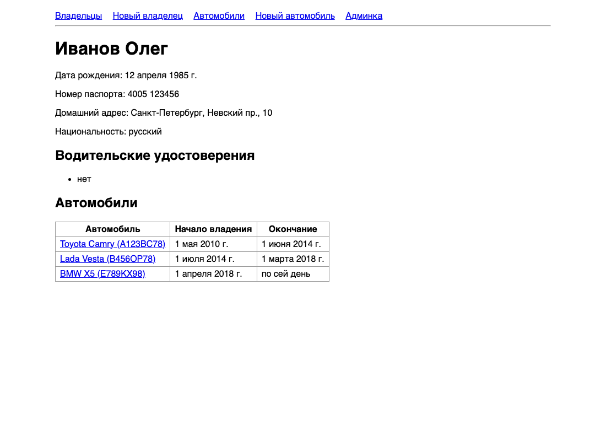

## Практика 2.2. Связь М:М, представления и формы

**Связь автомобиля с владельцем** - `ManyToManyField` с `through='Ownership'`: у владения
есть свои атрибуты (даты), поэтому промежуточная модель описана явно.

```python
owners = models.ManyToManyField(settings.AUTH_USER_MODEL, through='Ownership', related_name='cars')
```

**Представления.**

| Что | Тип | URL |
|---|---|---|
| Все владельцы | функция `owner_list` (FBV) | `/owners/` |
| Создание владельца через форму | функция `owner_create` (FBV) + `OwnerForm` | `/owner/create/` |
| Все автомобили | `CarListView` (`ListView`) | `/cars/` |
| Автомобиль по id | `CarDetailView` (`DetailView`) | `/car/<id>/` |
| Создание автомобиля | `CarCreateView` (`CreateView`) + `CarForm` | `/car/create/` |
| Обновление автомобиля | `CarUpdateView` (`UpdateView`) + `CarForm` | `/car/<id>/update/` |
| Удаление автомобиля | `CarDeleteView` (`DeleteView`) | `/car/<id>/delete/` |

??? info "views.py"
    ```python
    --8<-- "students/K3339/laboratory_works/Shaykhiev_Eldar/practical_works/django_project_shaykhiev/project_first_app/views.py"
    ```

??? info "forms.py"
    ```python
    --8<-- "students/K3339/laboratory_works/Shaykhiev_Eldar/practical_works/django_project_shaykhiev/project_first_app/forms.py"
    ```

Через форму добавлены ещё три владельца (Смирнова, Кузнецов, Ахмедов) и четыре автомобиля.
У Skoda через форму обновления изменён цвет, Renault удалён.

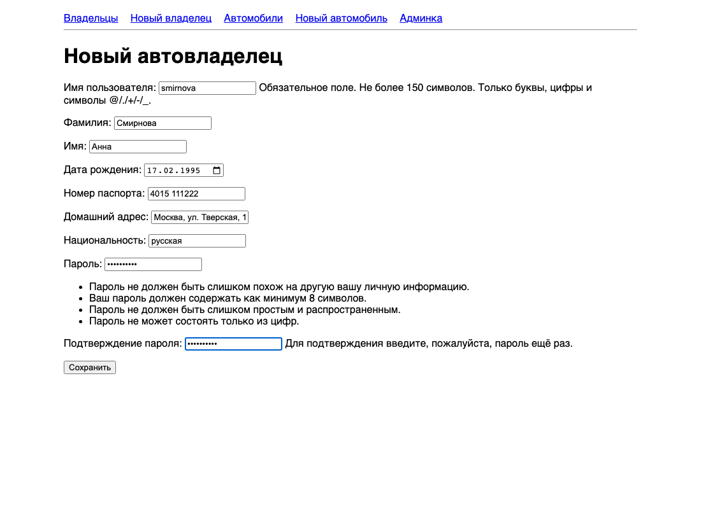

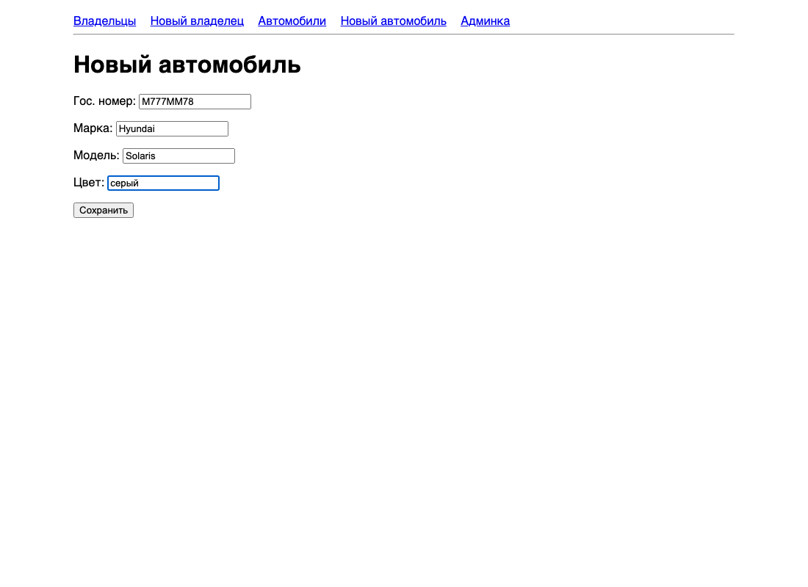

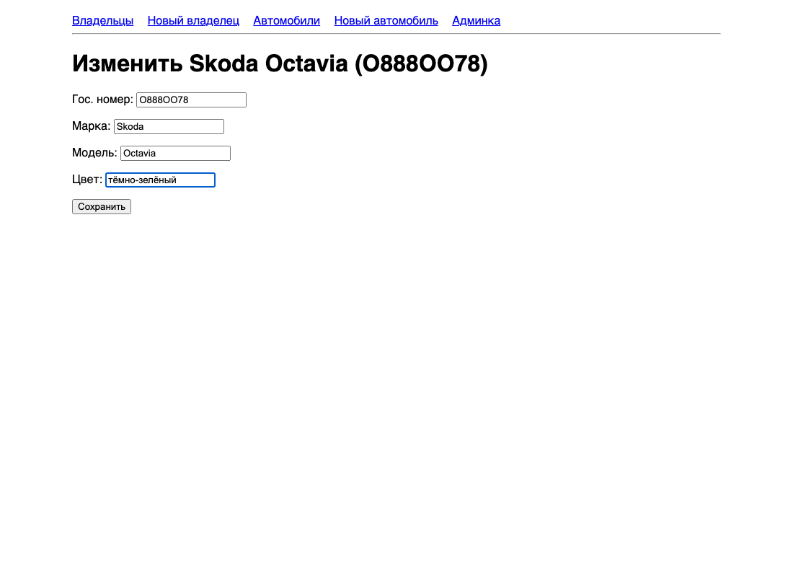

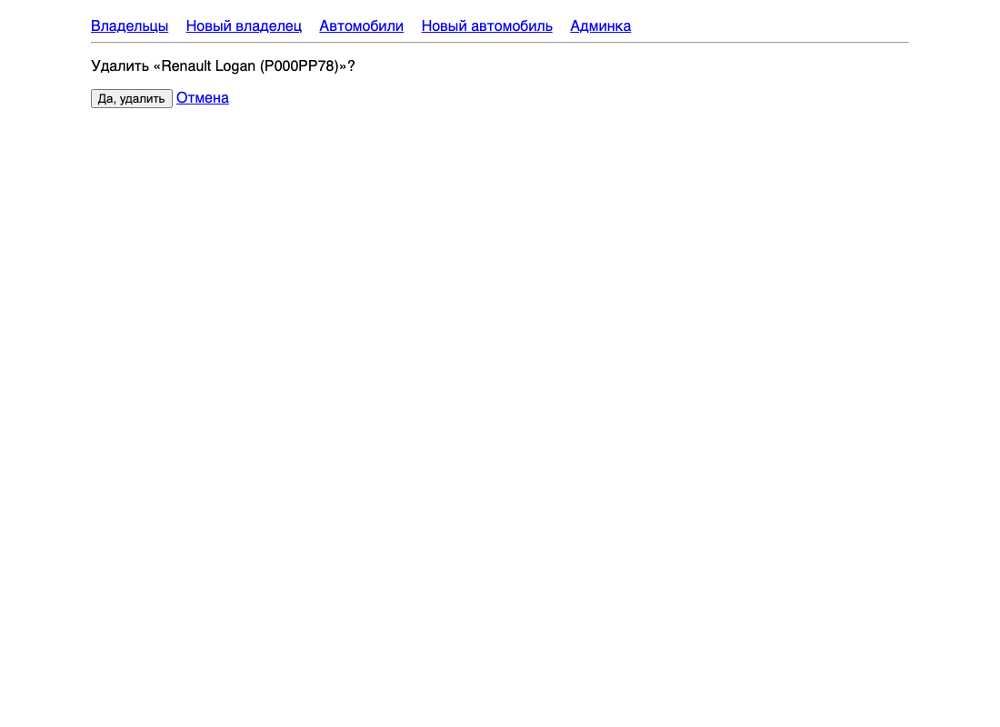

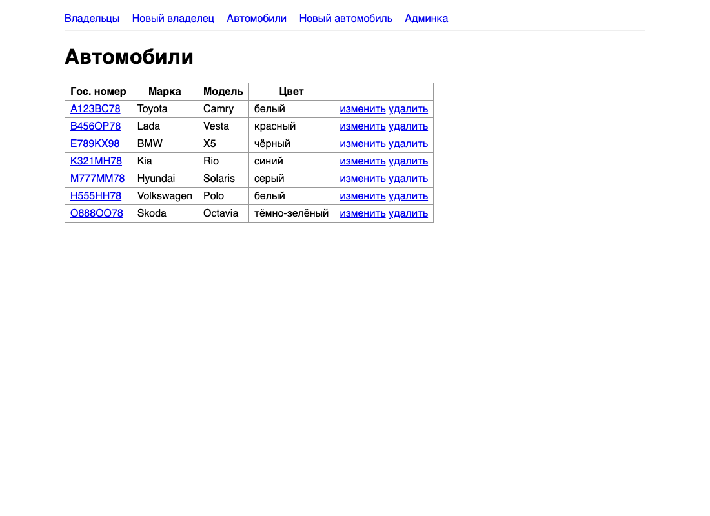

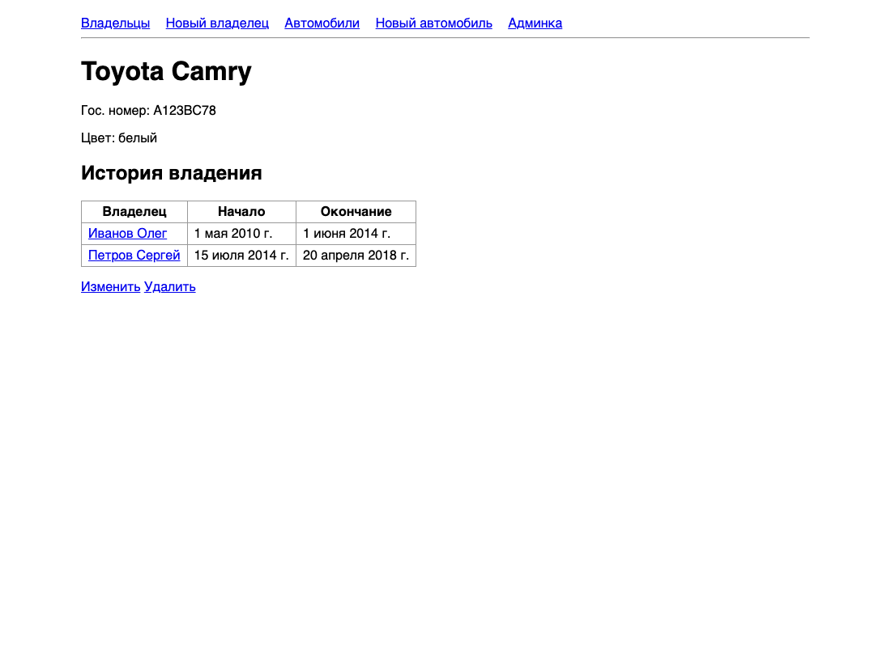

## Практика 2.3. Владелец автомобиля - пользователь

Модель пользователя расширена через `AbstractUser`, как рекомендует методичка: `CarOwner`
наследует все поля стандартного пользователя и добавляет номер паспорта, домашний адрес,
национальность и дату рождения. `AUTH_USER_MODEL = 'project_first_app.CarOwner'` задан до
первой миграции, а остальные модели ссылаются на пользователя через `settings.AUTH_USER_MODEL`.

**Админка.** `CarOwnerAdmin` наследует `UserAdmin` и добавляет блок «Данные автовладельца» на
страницы создания и редактирования.

```python title="project_first_app/admin.py"
--8<-- "students/K3339/laboratory_works/Shaykhiev_Eldar/practical_works/django_project_shaykhiev/project_first_app/admin.py"
```

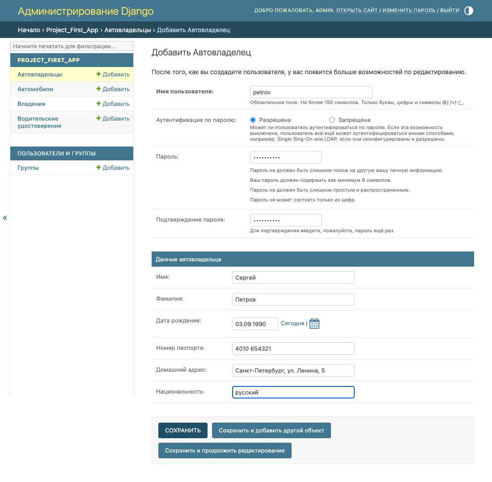

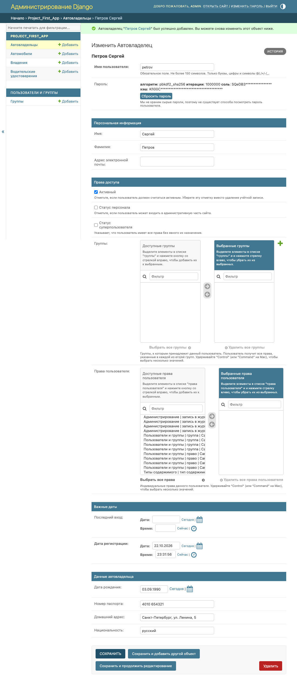

**Вывод информации о пользователях.** Страницы владельца и списка владельцев показывают паспорт,
адрес, национальность и машины. Суперпользователь в списке не показывается: он тоже
`CarOwner`, но машин у него нет.

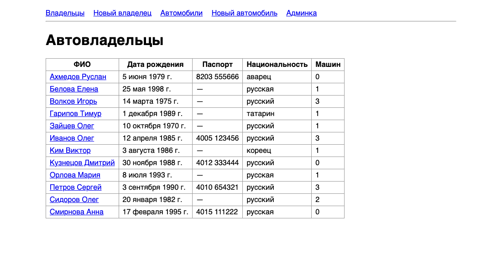

**Интерфейс создания пользователя** - `OwnerForm` наследует `UserCreationForm`: логин и
пароль с проверкой берутся из стандартной формы, к ним добавлены новые поля. После сохранения
пользователь попадает на страницу созданного владельца.

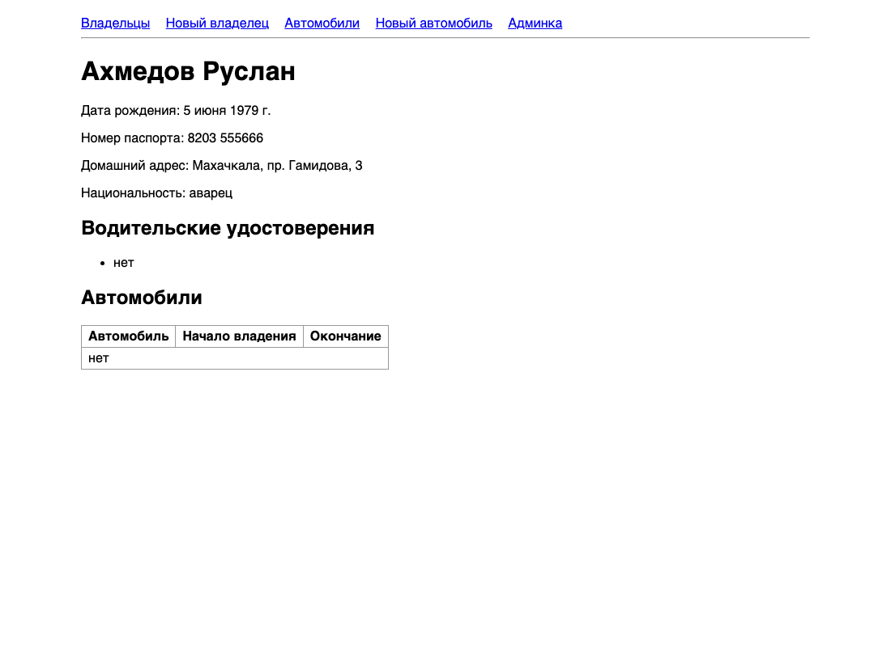
